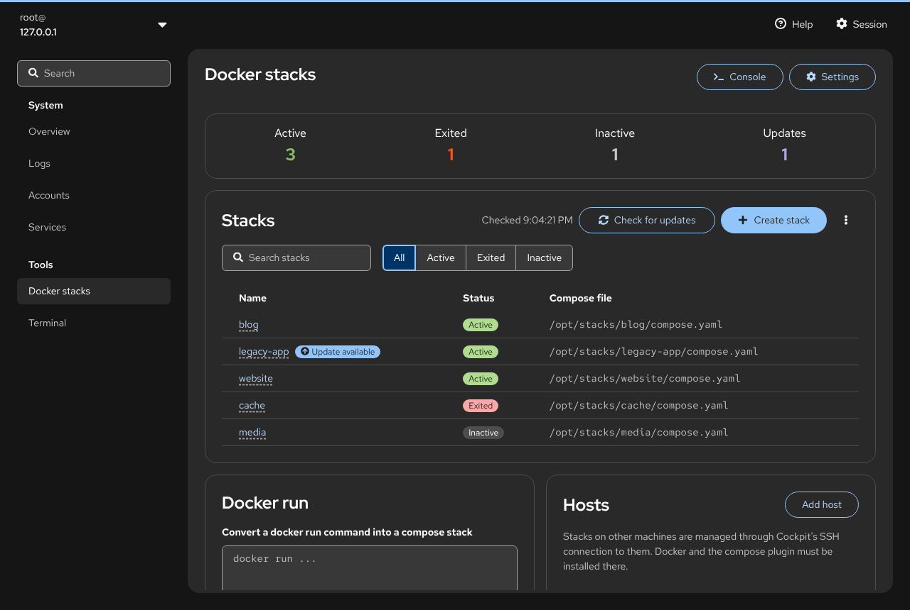
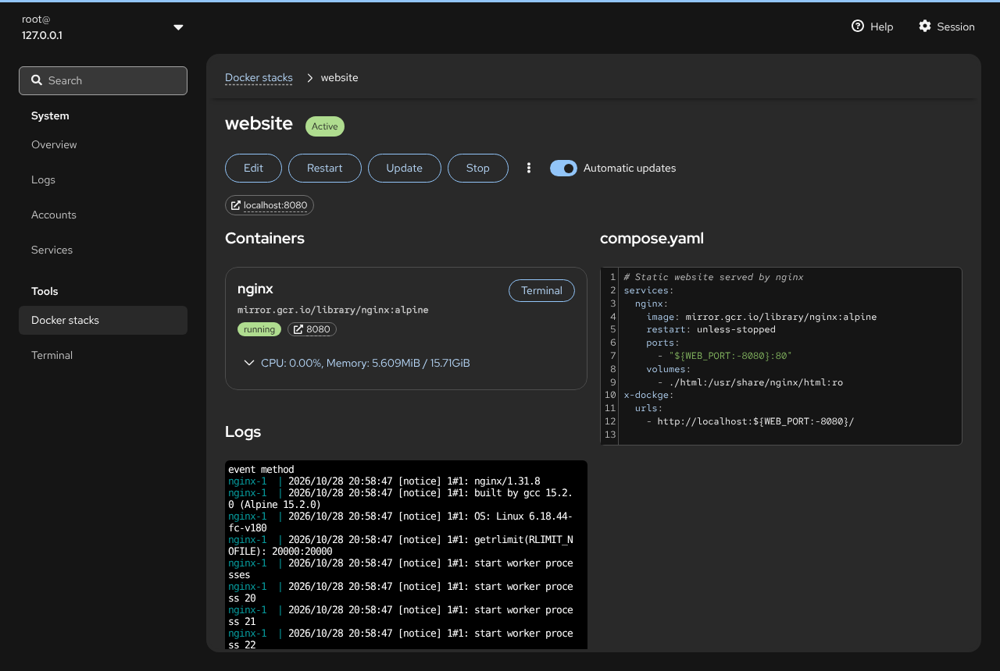

# cockpit-dockerstacks: Docker Compose stacks in Cockpit

A [Cockpit](https://cockpit-project.org/) module for managing Docker Compose
stacks. It is a port of [Dockge](https://github.com/louislam/dockge) to
Cockpit: the same features, running inside the Cockpit web console with
PatternFly, Cockpit's login and privilege handling, and no extra daemon. On top
of what Dockge does, it checks for newer images, can update stacks
automatically, and downloads and imports stacks as archives.


* **[User guide](docs/user-guide.md)**: every page and dialog, step by step
* **[Releases](https://github.com/avandeputte/cockpit-dockerstacks/releases)**: `.rpm` and `.deb` packages

## Contents

* [Features](#features)
* [Screenshots](#screenshots)
* [Requirements](#requirements)
* [Installing](#installing)
* [Getting started](#getting-started)
* [Image updates](#image-updates)
* [Downloading and importing stacks](#downloading-and-importing-stacks)
* [Multiple hosts](#multiple-hosts)
* [Files and settings](#files-and-settings)
* [How it works](#how-it-works)
* [Coming from Dockge](#coming-from-dockge)
* [Development](#development)
* [Packaging and releasing](#packaging-and-releasing)
* [License](#license)

## Features

* **Stack list** with Active / Exited / Inactive / Updates counters, search
  and status filter. Compose projects started outside the module are listed
  too, marked "Not managed".
* **Compose editor**: `compose.yaml` and `.env` editors with syntax
  highlighting and live validation, next to form editors for each service
  (image, ports, volumes, restart policy, environment, container name,
  networks, depends on), networks, and the URLs shown on the stack page.
  Comments in the YAML are kept when you use the forms.
* **Folder picker for bind mounts**: choose the host folder of a volume by
  browsing the server instead of typing the path.
* **Stack actions**: Deploy, Save, Start, Stop, Restart, Update (pull and
  recreate), Stop and remove containers, Delete. The output of
  `docker compose` streams into a terminal on the page.
* **Containers**: status, published ports as links, CPU and memory, per-service
  start/stop/restart, and an interactive terminal (`bash` or `sh`) in each
  container.
* **Logs**: a live `docker compose logs -f` terminal for each stack.
* **Console**: a shell in the stacks directory (opt-in).
* **docker run → compose**: paste a `docker run` command and get a stack.
* **Image updates** (not in Dockge): "Update available" on stacks and
  containers, checked against the registries without pulling anything.
* **Automatic updates** (not in Dockge): a daily or weekly systemd timer that
  pulls newer images and restarts running stacks, even when nobody has Cockpit
  open. Stacks can opt out one by one.
* **Download and import** (not in Dockge): download one stack or all stacks of
  a host as a `.tar.gz`, and import such an archive on the same or another host.
* **Multiple hosts**: manage stacks on other machines through Cockpit's SSH
  connection; no agent to install.
* **Cockpit integration**: Cockpit's login, administrative access, light and
  dark theme, and translations.

## Screenshots

| | |
| --- | --- |
|  **Stack page**: containers, live logs and the compose file |  **Update available** for a stack and its container |
|  **Editing** with service forms next to the YAML |  **Choosing a folder** on the server for a bind mount |
|  **docker run** command on the overview |  **Converted** into a new stack |
|  **Settings**, including update checks and automatic updates |  **Terminal** in a container |
|  **Download** all stacks |  **Import** stacks from an archive |
|  **Dark theme**: overview |  **Dark theme**: stack page |

## Requirements

* Cockpit 137 or later (tested with 362)
* Docker Engine with the compose plugin (`docker compose`) on each managed host
* `python3` on each host, for image update checks (Cockpit's bridge needs it
  anyway)
* For other hosts: Cockpit must be able to log in to them over SSH, for example
  with SSH keys. Recent Cockpit releases need `AllowMultiHost = yes` in
  `/etc/cockpit/cockpit.conf`.

## Installing

Download the package for your distribution from the
[latest release](https://github.com/avandeputte/cockpit-dockerstacks/releases/latest)
and install it with the package manager, so that dependencies are pulled in:

```sh
# Fedora, RHEL, CentOS Stream, AlmaLinux, Rocky Linux, openSUSE
sudo dnf install ./cockpit-dockerstacks-*.noarch.rpm

# Debian, Ubuntu
sudo apt install ./cockpit-dockerstacks_*_all.deb
```

Then open Cockpit (`https://your-server:9090`) and choose **Docker stacks**
under **Tools**. Reload the page if Cockpit was already open.

The packages depend on `cockpit-bridge`. Docker itself is not a package
dependency, because it can come from Docker's own repositories, your
distribution or a static install; make sure `docker compose version` works.

**Upgrading** is installing the newer package the same way. **Removing** is
`sudo dnf remove cockpit-dockerstacks` or `sudo apt remove cockpit-dockerstacks`;
your stacks in `/opt/stacks` and the settings in `/etc/cockpit/docker.json` are
left alone.

**Upgrading from `cockpit-docker` 0.1.0**: the package was renamed. The new
package replaces the old one with `dnf install` and `apt install`; a plain
`dpkg -i` refuses because it does not resolve the replacement.

**From source**:

```sh
git clone https://github.com/avandeputte/cockpit-dockerstacks.git
cd cockpit-dockerstacks
make && sudo make install PREFIX=/usr
```

This needs Node.js and npm. A source tarball with a pre-built `dist/`
(`cockpit-dockerstacks-*.tar.xz`, on the release page) only needs
`sudo make install PREFIX=/usr`.

## Getting started

1. Open **Docker stacks** and turn on administrative access in Cockpit's top
   bar (or put your user in the `docker` group, see [How it works](#how-it-works)).
2. Click **Create stack**, give it a name, add a container with an image (for
   example `nginx:alpine`), and click **Deploy**. Or paste a `docker run`
   command in the **Docker run** card and click **Convert to compose**.
3. The stack page shows its containers, the logs and the compose file. Use
   **Edit** to change it, **Update** to pull newer images and recreate the
   containers, and the kebab menu for **Download**, **Check for updates**,
   **Stop and remove containers** and **Delete**.

Existing Dockge users: the default stacks directory is `/opt/stacks`, the same
as Dockge, so existing stacks show up as they are.

The [user guide](docs/user-guide.md) describes every page and option.

## Image updates

The module knows when a newer image exists for a running container, without
downloading it. For each image it asks the registry for the digest of the tag
(an HTTP `HEAD` request for the manifest) and compares it with the digest that
the local image was pulled with. On Docker Hub these requests don't count
against the pull rate limit.

* Checks run when the page opens (turn this off in **Settings → Image
  updates**) and when you click **Check for updates** on the overview or in a
  stack's menu.
* Stacks and containers with a newer image get an **Update available** label,
  the overview counts them under **Updates**, and the stack's **Update**
  button turns primary. Clicking it runs `docker compose pull` and
  `docker compose up -d`.
* Docker Hub, GHCR, Quay, GitLab, self-hosted registries and other registries
  that implement the registry API work. Logins come from Docker's
  `config.json` (`docker login` as root); credential helpers (`credsStore`)
  are not supported, so private images on such setups show **Update check failed**.
* Images pinned by digest (`image@sha256:…`) and images that were built
  locally are never reported as outdated.

### Automatic updates

**Settings → Automatic updates** can be **Off**, **Daily** or **Weekly**. When
turned on, the module installs on that host:

* `/usr/local/libexec/cockpit-dockerstacks-update`, the update checker
* `/etc/systemd/system/cockpit-dockerstacks-update.service` and `.timer`

The timer runs with a random delay of up to an hour, also when nobody has Cockpit
open, and catches up on a missed run after the machine was off. It
checks every **running** stack in the stacks directory and, for those with
newer images, runs `docker compose pull` and `docker compose up -d`. Stopped
stacks are never started. Old images are not pruned.

To keep a stack on its current images, turn off **Automatic updates** on its
page. The list of excluded stacks is saved in the host's settings.

Turning automatic updates off again removes the timer, service and script.
The log of each run is in the journal:

```sh
journalctl -u cockpit-dockerstacks-update.service
systemctl list-timers cockpit-dockerstacks-update.timer
```

or click **Show the log of automatic updates** in Settings to open it in
Cockpit's Logs page.

## Downloading and importing stacks

**Download** a single stack from the kebab menu on its page, or all stacks of
a host with **Download all** in the kebab menu of the stack list. The archive
is a `.tar.gz` with the layout of the stacks directory:

```
stacks-myserver-2026-10-28.tar.gz
├── global.env              (optional)
├── blog/
│   ├── compose.yaml
│   └── .env
└── website/
    ├── compose.yaml
    └── html/               (only with "Include all other files")
```

By default only the compose file and `.env` of each stack are included. Tick
**Include all other files in the stack directories** to also take bind-mounted
data and anything else in them; files that running containers write to may be
inconsistent, so stop the stack first for a clean copy.

**Import stacks** (same menu) uploads such an archive, or any `.tar.gz` with
one directory per stack, and lists the stacks in it. Stacks that already exist are marked **Exists** and are only overwritten
when you tick them. Optionally replace `global.env`. Imported stacks are saved,
not started: deploy them from their page. This is also how to move stacks from
one host to another.

## Multiple hosts

The **Hosts** card on the overview adds other machines (`user@host` or
`host`). The module reaches them through Cockpit's own SSH connection, so
there is no agent or open port to set up, but Cockpit must be able to log in
there (SSH keys are easiest). Each host has its own stacks directory,
settings, update checks and automatic update timer; with more than one host,
the stack list shows which host each stack is on.

Docker and the compose plugin must be installed on every host. The module
itself only needs to be installed on the machine you log in to.

## Files and settings

| What | Where |
| --- | --- |
| Stacks | `/opt/stacks/<name>/compose.yaml` (or `compose.yml`, `docker-compose.yaml`, `docker-compose.yml`) and `.env` |
| Global environment | `global.env` in the stacks directory, passed to every stack before its own `.env` |
| Settings | `/etc/cockpit/docker.json` on each host |
| Automatic updates | `/usr/local/libexec/cockpit-dockerstacks-update`, `/etc/systemd/system/cockpit-dockerstacks-update.{service,timer}` |
| Module | `/usr/share/cockpit/docker` |
| Other hosts | Cockpit's machine list (`~/.config/cockpit/machines.json` and `/etc/cockpit/machines.d`) |

Settings, all per host: stacks directory, primary hostname (used for the
links to published ports), `global.env`, image update checks, automatic
updates, and the console.

## How it works

There is no backend service. The browser code runs `docker compose ...` and
reads and writes the stack files through the Cockpit bridge (`cockpit.spawn()`
and channels) with `superuser: "try"`: it uses administrative access when the
user has turned it on, and otherwise works for users in the `docker` group
(who then need write access to the stacks directory). Other hosts use the
`host` option of those channels, which goes through Cockpit's SSH connection.

The update checker, `src/docker-updates.py`, is plain Python with only the
standard library. The page runs it with the host's `python3`; the systemd
timer runs the installed copy of the same script.

## Coming from Dockge

| Dockge | This module |
| --- | --- |
| Stack list with search and status | **Docker stacks** page with counters, search and status filter |
| Compose editor (`compose.yaml` + `.env`) | YAML and `.env` editors plus form editors per service; comments are kept |
| Deploy / Save / Start / Stop / Restart / Update / Down / Delete | Same actions; `docker compose` output streams into a terminal |
| Per-service start / stop / restart, status, CPU and memory | Service cards, refreshed every 5 seconds |
| Combined logs terminal | `docker compose logs -f` terminal on the stack page |
| Container "Bash" terminal | Terminal page per service (`bash` or `sh`) |
| Console | Shell in the stacks directory (opt-in in Settings) |
| `docker run` → compose | **Docker run** card (composerize, in the browser) |
| Agents | **Hosts** card, through Cockpit's SSH connection |
| Settings: primary hostname, `global.env` | Settings dialog: stacks directory, primary hostname, `global.env`, image updates, console |
| Login, 2FA, password, appearance | Cockpit's login, administrative access, theme and language |
| (not in Dockge) | Image update checks, automatic updates, download and import, folder picker |

`x-dockge` URLs in compose files are shown on the stack page, so compose files
can move between Dockge and this module both ways.

## Development

Follows the layout of Cockpit's
[starter-kit](https://github.com/cockpit-project/starter-kit) and the
[development guide](https://docs.cockpit-project.org/cockpit-guide/latest/guide/development.html):
TypeScript, React, PatternFly 6, built with esbuild.

```sh
make                 # fetch pkg/lib from Cockpit, npm install, build dist/
make devel-install   # symlink dist/ to ~/.local/share/cockpit/docker
make watch           # rebuild on changes
npm run eslint       # lint
npx tsc --noEmit     # type check
npm test             # unit tests (QUnit with node, unittest with python3)
make check           # browser integration tests (needs Cockpit's test VMs)
```

After `make devel-install`, log in to Cockpit and open **Docker stacks**;
reload the page after each rebuild.

Source layout:

* `src/util.ts`: pure helpers (compose YAML, env substitution, ports, volumes,
  docker output parsing), unit tested in `test/unit/`
* `src/docker.ts`: everything that touches a host, through `cockpit.spawn()`
  and channels: stacks, settings, update checks, the update timer, download
  and import
* `src/docker-updates.py`: registry digest checks and the automatic updater,
  unit tested in `test/unit/test_updates.py`
* `src/model.ts`: hosts, stack list, update state, polling
* Pages and dialogs: `src/Overview.tsx`, `src/StackPage.tsx`,
  `src/ServiceCard.tsx`, `src/TerminalPages.tsx`, `src/SettingsDialog.tsx`,
  `src/Transfer.tsx` (download and import), `src/VolumeInput.tsx` and
  `src/FolderBrowser.tsx` (volumes and the folder picker)
* `test/check-application`: Cockpit browser integration test

The screenshots in `docs/screenshots` are 1280×860 captures of a running
Cockpit with demo stacks.

### Translations

User-visible strings use `cockpit.gettext()`; `make po/docker.pot` extracts
them. Put translations in `po/<lang>.po`.

## Packaging and releasing

```sh
make dist   # cockpit-dockerstacks-VERSION.tar.xz with a pre-built dist/
make rpm    # noarch RPM (needs rpmbuild)
make deb    # Debian/Ubuntu package (needs dpkg-deb)
```

The version comes from `git describe --tags`, or `make ... VERSION=1.2.3`.

The GitHub **build** workflow builds the tarball, RPM and deb on every push and
pull request and keeps them as workflow artifacts. To publish a release, either:

* push a tag `v1.2.3`, or
* run the **build** workflow by hand (Actions → build → Run workflow) with
  **release** set to `v1.2.3`. It builds with that version, creates the tag and
  the GitHub release, and attaches the tarball, `.rpm` and `.deb`. Running it
  again for an existing release replaces the files.

## License

LGPL-2.1-or-later, like Cockpit. Code ported from Dockge is MIT licensed, see
[LICENSE.dockge](LICENSE.dockge).
