# User guide

This guide walks through every page and dialog of **Docker stacks**. For
installation and an overview, see the [README](../README.md).

* [Access and permissions](#access-and-permissions)
* [The overview](#the-overview)
* [Creating a stack](#creating-a-stack)
* [Converting a docker run command](#converting-a-docker-run-command)
* [The stack page](#the-stack-page)
* [Editing a stack](#editing-a-stack)
* [Volumes and the folder picker](#volumes-and-the-folder-picker)
* [Container terminals and the console](#container-terminals-and-the-console)
* [Image updates](#image-updates)
* [Automatic updates](#automatic-updates)
* [Downloading stacks](#downloading-stacks)
* [Importing stacks](#importing-stacks)
* [Other hosts](#other-hosts)
* [Settings](#settings)
* [Troubleshooting](#troubleshooting)

## Access and permissions

Docker stacks runs every command as the user logged in to Cockpit, with
administrative access when it is turned on (the **Limited access** /
**Administrative access** button in Cockpit's top bar).

* With administrative access everything works: stacks, settings, the console
  and automatic updates.
* Without it, users in the `docker` group can see and control containers. To
  create and edit stacks they also need write access to the stacks directory,
  and saving settings or turning on automatic updates needs administrative
  access, because those write to `/etc`.

## The overview

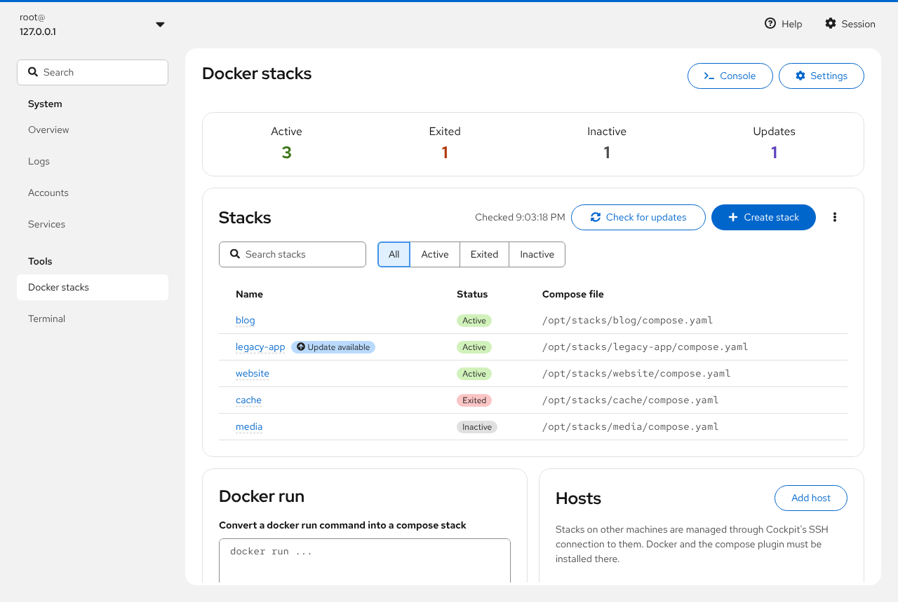

The top of the page counts the stacks by state:

* **Active**: at least one container is running
* **Exited**: containers exist but none are running
* **Inactive**: there is a compose file but no containers (never deployed, or
  stopped and removed)
* **Updates**: stacks with a newer image in the registry

The **Stacks** card lists every stack with its status and compose file. Search
by name, or filter with **All / Active / Exited / Inactive**. Compose projects
that were started from a directory outside the stacks directory are listed as
**Not managed**: you can see them, but edit them where they live.

The buttons next to the list:

* **Check for updates** asks the registries again; the time of the last check
  is shown next to it.
* **Create stack** opens an empty compose editor.
* The kebab menu has **Download all** and **Import stacks**.

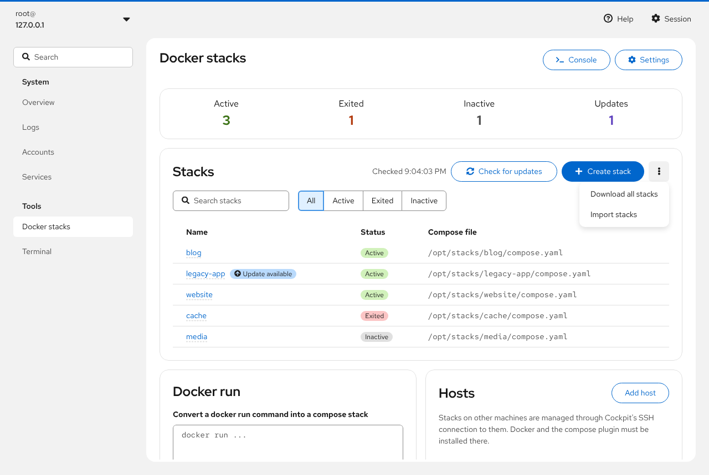

At the top right, **Console** opens a shell in the stacks directory (when
enabled) and **Settings** opens the [settings](#settings).

Below the list are the **Docker run** card and the **Hosts** card.

## Creating a stack

Click **Create stack**. The page has three parts:

1. **General**: the stack name, which becomes the directory name. Lowercase
   letters, digits, `_` and `-` only.
2. **Containers**: type a name in *New container name…* and click **Add
   container**, then **Edit** the container to set its image and options (see
   [Editing a stack](#editing-a-stack)).
3. **Extra**: **URLs** to show as links on the stack page, for example the web
   interface of the application. They are saved as `x-dockge: urls:` in the
   compose file, like Dockge does.

On the right are the `compose.yaml` and `.env` editors and the networks. You
can write the YAML directly or use the forms; both stay in sync.

Then:

* **Save** writes `compose.yaml` and `.env` to `/opt/stacks/<name>/` without
  starting anything.
* **Deploy** saves and runs `docker compose up -d`. The output appears in a
  terminal on the page, and you land on the stack page when it is done.

## Converting a docker run command

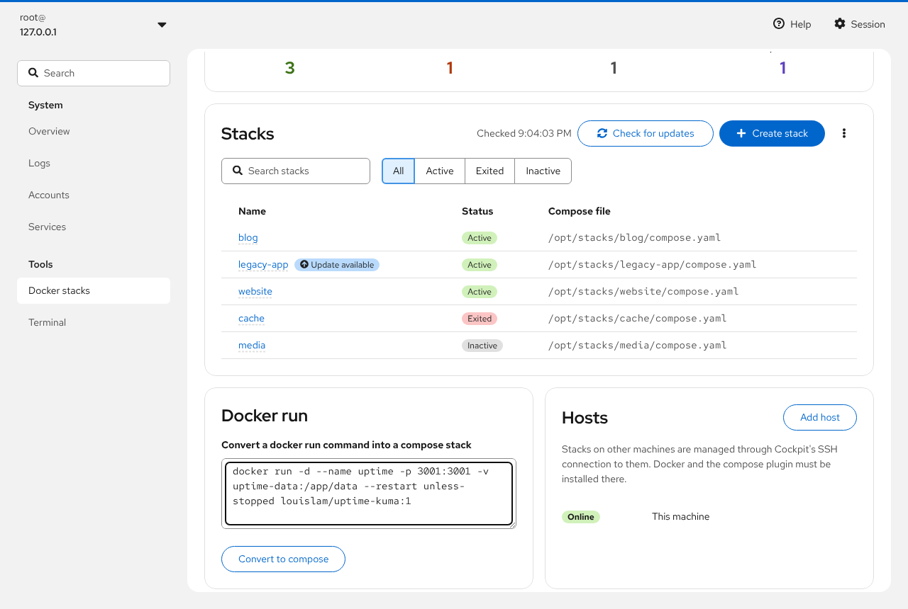

Paste a `docker run ...` command into the **Docker run** card on the overview
and click **Convert to compose**. It is converted in the browser (with
composerize, as in Dockge) and opens as a new stack, with the stack name taken
from `--name` when there is one.

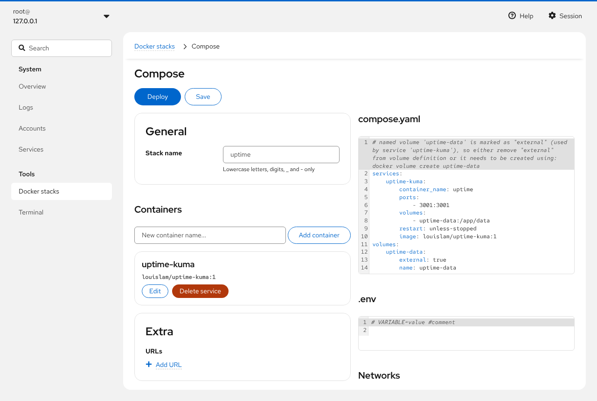

Check the result before deploying. For example, named volumes come out as
`external: true`, which means they must already exist; remove those two lines
to let compose create the volume.

## The stack page

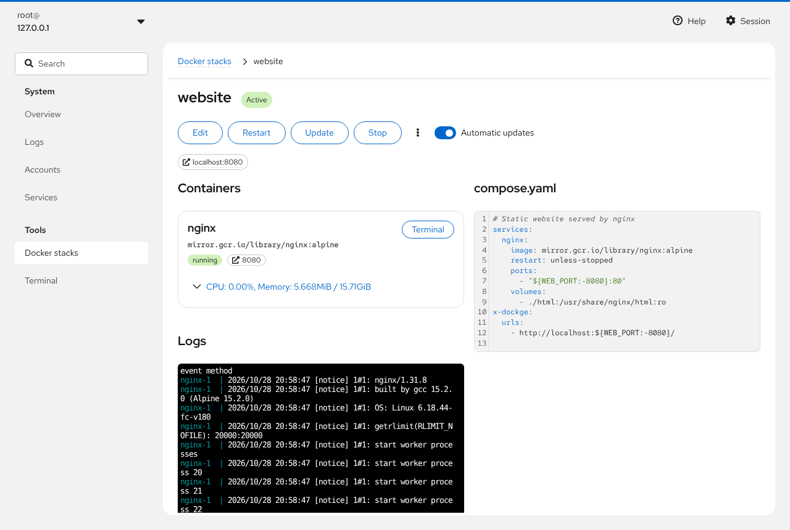

The header shows the stack name, its status, and **Update available** when a
container has a newer image. Published ports and URLs appear as links below
the buttons; they use the **primary hostname** from Settings.

Buttons, depending on the state of the stack:

| Button | Does |
| --- | --- |
| **Edit** | Opens the editor |
| **Deploy** | `docker compose up -d` (for an inactive stack) |
| **Start** / **Stop** / **Restart** | `docker compose start` / `stop` / `restart` |
| **Update** | `docker compose pull`, then `up -d`: pulls newer images and recreates the containers that changed. Primary when an update is available |
| ⋮ **Check for updates** | Asks the registries about this stack's images |
| ⋮ **Download** | Downloads the stack as a `.tar.gz` |
| ⋮ **Stop and remove containers** | `docker compose down`: the stack becomes inactive; volumes and files stay |
| ⋮ **Delete** | `docker compose down`, then deletes the stack directory with `compose.yaml`, `.env` and everything else in it |
| **Automatic updates** switch | Takes the stack in or out of [automatic updates](#automatic-updates); only shown when they are turned on in Settings |

**Containers** has a card for each service, with the image, state, published
ports and CPU and memory use, refreshed every 5 seconds. Expand the statistics
for network and block I/O and the number of processes. Each card has
**Start**, **Stop** or **Restart** for that service only, and **Terminal**.

**Logs** follows `docker compose logs -f` for all services. When you run an
action, its output replaces the logs until it is done.

On the right, `compose.yaml` and `.env` are shown read-only until you click
**Edit**.

## Editing a stack

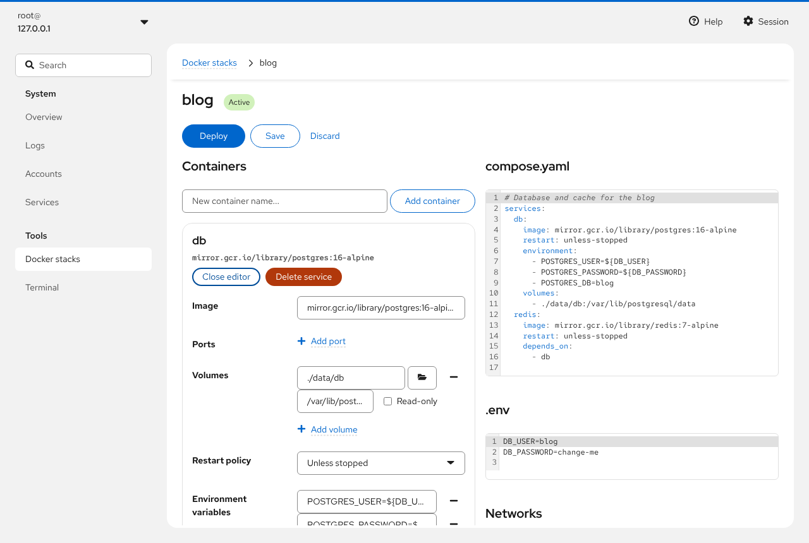

Click **Edit**. Each container card gets **Edit** (open its form) and **Delete
service**. The form has:

* **Image**, for example `nginx:alpine` or `ghcr.io/owner/app:1.2`
* **Ports**: `host:container`, for example `8080:80`
* **Volumes**: see the [next section](#volumes-and-the-folder-picker)
* **Restart policy**: Default (no), Always, On failure, Unless stopped
* **Environment variables**: `NAME=value`; `${VAR}` refers to `.env` or
  `global.env`
* **Container name**
* **Networks** the service joins
* **Depends on**: services that must start first

Add a service with *New container name…* and **Add container**.

**Networks** (on the right) defines the stack's internal networks and picks
external networks, existing docker networks that the stack joins.

Everything you do in the forms is written to the YAML immediately, and edits
in the YAML show up in the forms. Comments and formatting in the YAML are
kept. Errors in the YAML are shown under the editor and block saving.

Finish with **Deploy** (save and apply), **Save** (save only) or **Discard**.

## Volumes and the folder picker

Each volume has a **host folder or volume name**, a **path in the container**
and a **Read-only** checkbox, and is saved in compose's short form
`SOURCE:TARGET[:ro]`.

* A source that starts with `/`, `./` or `../` is a **bind mount** of a folder
  on the host. Relative paths are relative to the stack directory, so
  `./data` is `/opt/stacks/<stack>/data`.
* Anything else is a **named volume** managed by docker.

Click the folder button next to the source to browse the server instead of
typing:

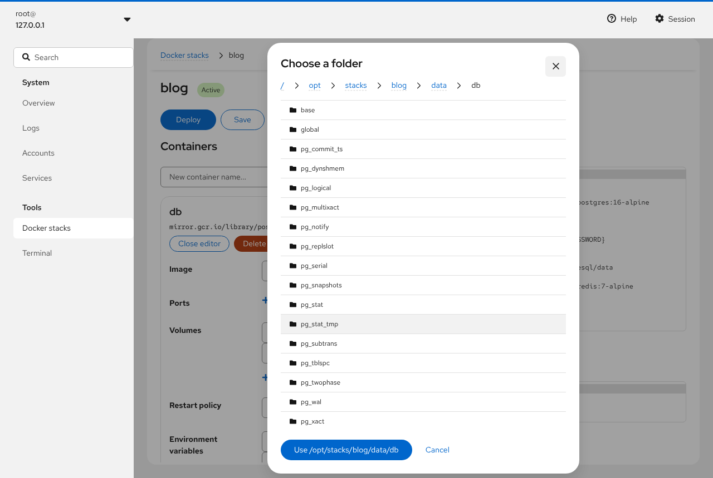

The browser starts at the folder already in the field, or the stack directory
for a new volume. Click a folder to open it, use the breadcrumbs to go up, and
click **Use /path** to take the folder you are in. Folders inside the stack
directory are written as relative paths (`./data/db`), others as absolute
paths. The picker lists the folders of the host the stack is on, with
administrative access when it is turned on.

Long-form volume entries (YAML objects) are shown as they are; edit those in
the YAML.

## Container terminals and the console

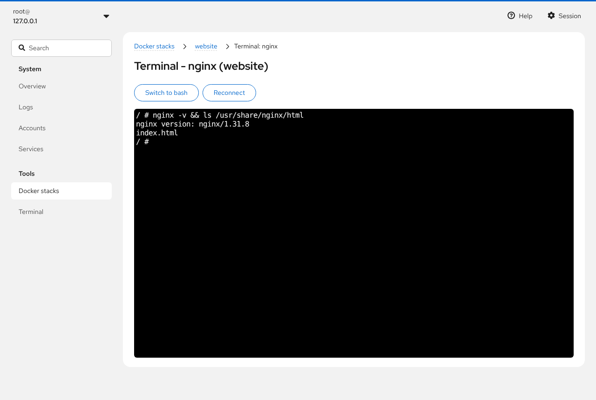

**Terminal** on a container card opens an interactive shell in that container
(`docker compose exec`). It starts `bash`; images without bash, such as Alpine
ones, can use **Switch to sh**. **Reconnect** starts a new shell after you
exit.

The **Console** button on the overview opens a shell on the host in the stacks
directory. It is off by default; turn it on in Settings. It runs with
administrative access when that is turned on, so treat it like a root shell.

## Image updates

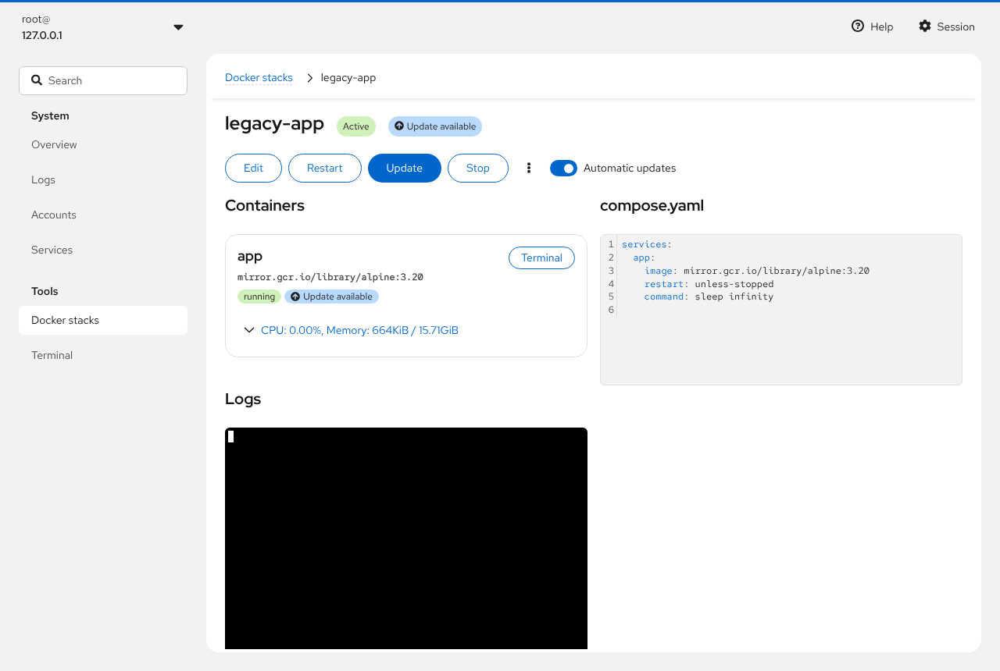

When the page opens (unless turned off in Settings), and when you click
**Check for updates**, the module asks each image's registry for the current
digest of its tag and compares it with the image the container runs. Nothing
is downloaded, and Docker Hub does not count these requests against its pull
limit.

What you can see:

* **Update available** on the stack in the list, on the stack page and on each
  container with a newer image; hover it for the image names
* the **Updates** counter on the overview
* **Update check failed** when a registry could not be asked, for example a
  private image without a login, or a registry that is down; hover it for the
  reason

Images pinned to a digest (`image@sha256:…`) and images built locally are not
checked.

For private registries, log in with `docker login` as root on the host. Logins
stored by a credential helper (`credsStore` in `~/.docker/config.json`) cannot
be read.

To apply an update, click **Update** on the stack page. It pulls the new
images and recreates only the containers that changed.

## Automatic updates

In **Settings**, set **Automatic updates** to **Daily** or **Weekly** and
click **Save**. This installs a systemd timer on that host:

* `/etc/systemd/system/cockpit-dockerstacks-update.timer`: runs daily or
  weekly with a random delay of up to an hour, and catches up after the
  machine was off
* `/etc/systemd/system/cockpit-dockerstacks-update.service`: runs the update
* `/usr/local/libexec/cockpit-dockerstacks-update`: the checker script

Each run looks at the stacks in the stacks directory. For a **running** stack
with a newer image it runs `docker compose pull` and `docker compose up -d`.
Stopped and inactive stacks are left alone, and old images are not removed
(run `docker image prune` for that).

To exclude a stack, turn off the **Automatic updates** switch on its page.
Excluded stacks still show **Update available**, and you can update them by
hand.

The log of each run is in the journal. Click **Show the log of automatic
updates** in Settings, or on the host:

```sh
journalctl -u cockpit-dockerstacks-update.service
systemctl list-timers cockpit-dockerstacks-update.timer
sudo systemctl start cockpit-dockerstacks-update.service   # run it now
```

Setting **Automatic updates** back to **Off** removes the timer, the service
and the script.

## Downloading stacks

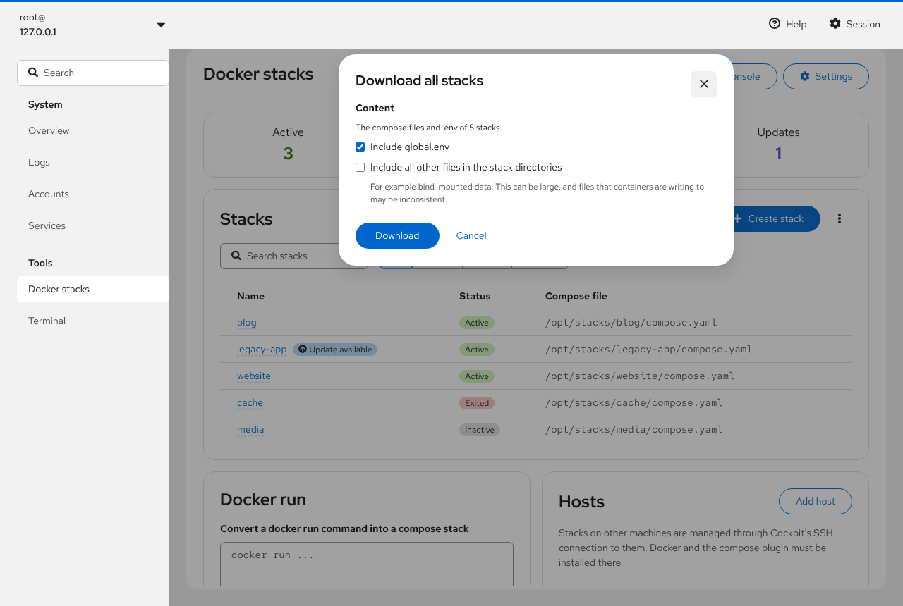

* One stack: **⋮ → Download** on its page.
* All stacks of a host: **⋮ → Download all** next to the stack list.

The dialog offers:

* **Include global.env** (download all only)
* **Include all other files in the stack directories**: also bind-mounted data
  and anything else in them. This can be large, and files that running
  containers write to may be inconsistent, so stop the stack first if you need
  a consistent copy.

The download is a `.tar.gz` named `<stack>-<date>.tar.gz` or
`stacks-<host>-<date>.tar.gz`, with one directory per stack at the top, the
same layout as the stacks directory. It is created on the host
with `tar`, so file permissions and ownership numbers are kept in the archive.

## Importing stacks

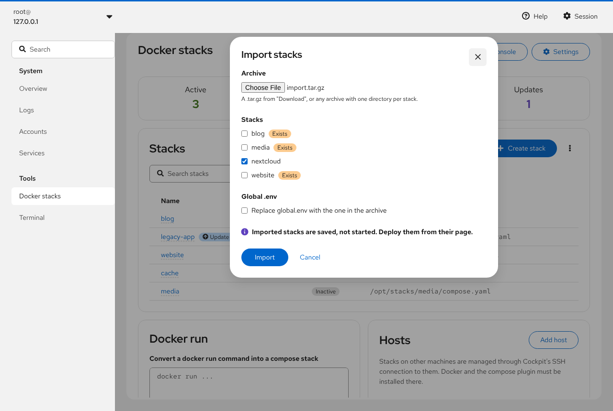

**⋮ → Import stacks** next to the stack list. Choose a `.tar.gz` made by
**Download**, or any `.tar.gz` that contains one directory per stack with a
compose file in it, at the top of the archive. A quick way to make one by
hand is `cd /opt/stacks && tar czf ~/stacks.tar.gz blog website`.

The dialog lists the stacks in the archive:

* New stacks are ticked.
* Stacks that already exist on this host are marked **Exists** and not ticked.
  Tick one to overwrite it: its directory is replaced by the one in the archive
  (**Exists, will be overwritten**).

Tick **Replace global.env with the one in the archive** to take that too.
**Import** copies the stacks into the stacks directory. They are saved, not
started: open each one and click **Deploy**.

Importing on another host is how to move or copy stacks between machines:
download on one, import on the other.

## Other hosts

The **Hosts** card on the overview lists the machines whose stacks are shown.
**Add host** takes `host`, `user@host` or `user@host:port` and an optional
display name; **Rename** and **Remove** change or drop one.

Hosts are reached through Cockpit's SSH connection, so Cockpit must be able to
log in there, ideally with SSH keys; the first connection may ask to accept the
host key or for a password. Newer Cockpit versions only allow this when
`/etc/cockpit/cockpit.conf` has:

```ini
[WebService]
AllowMultiHost = yes
```

Each host shows as **Online** or **Offline**. With more than one host, the stack
list gets a **Host** column, the create page asks which host to put the stack
on, and **Download all** and **Import** ask for the host. Every host has its
own Settings (opened with the host selected), its own update checks and its
own automatic update timer. Docker and the compose plugin must be installed on
each host; this module only needs to be installed where you log in.

## Settings

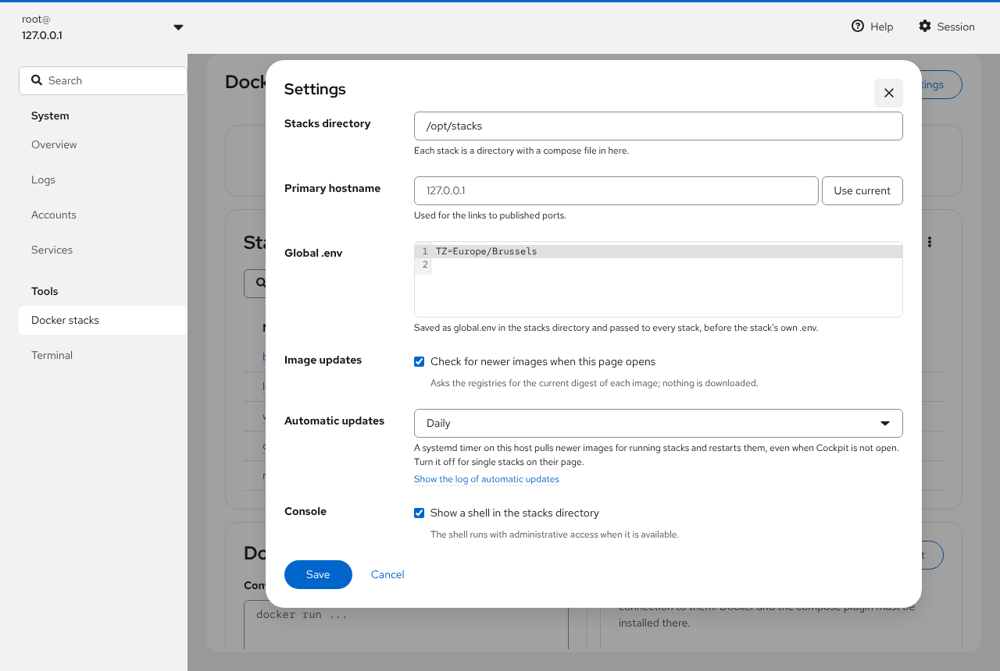

Settings are stored per host in `/etc/cockpit/docker.json`.

| Setting | Meaning |
| --- | --- |
| **Stacks directory** | Where stacks live, one directory per stack. Default `/opt/stacks`, the same as Dockge |
| **Primary hostname** | Host name used in the links to published ports. **Use current** takes the one in the browser's address bar |
| **Global .env** | Saved as `global.env` in the stacks directory and passed to every stack (`--env-file`) before its own `.env` |
| **Image updates** | Check for newer images when the page opens |
| **Automatic updates** | Off, Daily or Weekly; see [Automatic updates](#automatic-updates) |
| **Console** | Show the **Console** button with a shell in the stacks directory |

The list of stacks excluded from automatic updates is stored in the same file
(`autoUpdateExclude`).

## Troubleshooting

**No stacks are listed, or actions fail.** Check `docker info` and
`docker compose version` on the host, and that your user has administrative
access turned on or is in the `docker` group. The terminal output of a failed
action shows docker's error.

**A stack shows "Not managed".** Its compose file is outside the stacks
directory. Move its directory into the stacks directory, or change the stacks
directory in Settings.

**Update check failed.** Hover the label for the reason. "requires a login":
run `docker login <registry>` as root. "Too many requests": the registry is
rate limiting; try later. A registry that cannot be reached from the host
cannot be checked.

**Automatic updates did not update a stack.** The stack must be running and not
excluded. See `journalctl -u cockpit-dockerstacks-update.service`.

**Another host is Offline.** Open it once from Cockpit's host switcher to see
the SSH error, and check `AllowMultiHost` (see [Other hosts](#other-hosts)).

**The terminal shows "This browser does not support WebGL2".** The terminals
need WebGL2; enable hardware acceleration in the browser.
